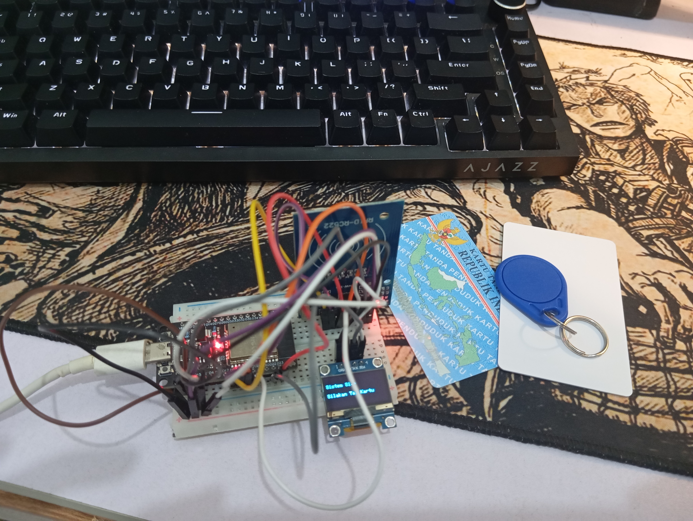

# 🚀 RFID Smart Macro: "Siri for Windows"

>Proyek ini adalah sistem otomatisasi laptop berbasis **ESP32** dan **RFID** yang menyamar sebagai *Keyboard Bluetooth*. Dengan menempelkan kartu RFID, kamu bisa membuka *lock screen* Windows dan menjalankan deretan aplikasi secara otomatis (Macro).

Proyek ini dibuat sebagai eksperimen seru untuk mengubah e-KTP dan kartu akses menjadi "kunci pintar" laptop.

## ✨ Fitur Utama

Proyek ini mendukung 3 mode berbeda menggunakan 3 kartu RFID:

| Jenis Kartu | Mode | Aksi yang Dilakukan |
| :--- | :--- | :--- |
| **Kartu Biru Kecil** | **Mode Kerja** | Unlock Windows -> Buka CMD -> Buka VS Code -> Buka Chrome -> Buka Dokumentasi Next.js -> Putar lagu di Spotify. |
| **Kartu Akses Lain** | **Mode Santai** | Unlock Windows -> Buka YouTube -> Memutar video spesifik -> Otomatis menekan tombol `F` (Fullscreen). |
| **e-KTP** | **Mode Panic** | Langsung mengunci layar Windows (`Windows + L`). Berguna saat ada orang mencurigakan mendekat. |

**Fitur Tambahan:**
- **Layar OLED 0.96":** Menampilkan status *real-time* (Mode Kerja, Akses Ditolak, Bluetooth Terhubung, dll).
- **Anti-Salah Ketik:** Fungsi khusus untuk mengetik password per karakter (dengan jeda) agar Windows tidak *miss* input.

---

## 🛠️ Komponen Hardware

Untuk merakit alat ini, kamu membutuhkan:
1. **ESP32 Development Board** (Bisa pakai WROOM, DevKit, atau Super Mini).
2. **Modul RFID MFRC522** (Pembaca kartu 13.56MHz).
3. **Layar OLED 0.96 Inch I2C** (4 Pin).
4. Kartu RFID (Kartu Biru, e-KTP, dll).
5. Kabel Jumper secukupnya.

---

## 🔌 Skema Kabel (Wiring)

Berikut adalah skema pin yang digunakan pada proyek ini:

**1. Modul RFID (MFRC522) ke ESP32 (SPI):**
- `SDA / SS` ➔ GPIO 5
- `RST` ➔ GPIO 15
- `SCK` ➔ GPIO 18
- `MISO` ➔ GPIO 19
- `MOSI` ➔ GPIO 23
- `VCC` ➔ 3.3V
- `GND` ➔ GND

**2. Layar OLED ke ESP32 (I2C):**
- `SDA` ➔ GPIO 21
- `SCL` ➔ GPIO 22
- `VCC` ➔ 3.3V
- `GND` ➔ GND

---

## 📚 Library yang Dibutuhkan

Sebelum melakukan *compile/upload*, pastikan kamu sudah menginstal library berikut di Arduino IDE (melalui **Sketch > Include Library > Manage Libraries**):

1. **`HijelHID_BLEKeyboard`** (Untuk fungsi Keyboard Bluetooth).
2. **`NimBLE-Arduino`** (Dependensi untuk BLE Keyboard).
3. **`MFRC522`** (Untuk sensor RFID).
4. **`Adafruit SSD1306`** & **`Adafruit GFX Library`** (Untuk layar OLED).

---

## ⚠️ Catatan Penting Sebelum Digunakan

1. **Pairing Bluetooth Pertama Kali:**
   Nyalakan ESP32, buka pengaturan Bluetooth di Windows, dan lakukan *pairing* manual dengan perangkat bernama `HijelHID KB`. Setelah terhubung, ESP32 akan otomatis terhubung di kemudian hari.
   
2. **Layout Keyboard Windows:**
   Pastikan bahasa *keyboard* di laptop kamu diatur ke **English (United States)** di layar *lock screen*. Jika tidak, karakter yang diketik oleh ESP32 akan berantakan.

3. **Ganti Password & UID Kartu:**
   Buka file `RFID-Smart-Macro.ino` dan ganti bagian berikut:
   ```cpp
   const char* passwordLaptop = "PasswordWindowsKamu";
   byte kartuKerja[] = {0x1, 0x4C, 0x26, 0x64}; // Ganti dengan UID kartu kamu
